# 🌐 AuraLocate — Premium Local Commerce & Real-Time Price Index

[](https://nextjs.org/)
[](https://react.dev/)
[](https://www.typescriptlang.org/)
[](https://tailwindcss.com/)
[](https://vercel.com/)

> **Verified Local Electronics Retailers. Real-Time In-Store Prices. Zero Courier Risk.**  
> *A high-trust discovery and reservation platform connecting discerning electronics buyers with certified offline showrooms across Bangalore.*

---

## 📖 Executive Summary & Mission

When purchasing high-ticket electronics (such as flagship titanium smartphones, 65" 4K OLED screens, 5-star inverter air conditioners, or AI front-load washers), relying on traditional e-commerce marketplaces introduces significant anxiety:
- **3 to 5 days delivery wait times**
- **Transit damage and courier drop risks**
- **Open-box delivery disputes & return policy friction**
- **Hidden 12–18% marketplace commissions baked into prices**

**AuraLocate** bridges the gap between offline retailers and modern digital buyers. It empowers brick-and-mortar dealers with a free digital showroom while enabling consumers to compare exact canonical model quotes in their neighborhood, lock prices for 24 hours with **₹0 advance deposit**, inspect the factory seal in person, and walk home with their device the same day.

---

## 📸 Visual Platform Tour

### 1. Interactive Homepage & Canonical Price Index
*Features live neighborhood switching (Indiranagar, Koramangala, HSR Layout, etc.), real-time store updates ticker, and interactive savings calculator.*

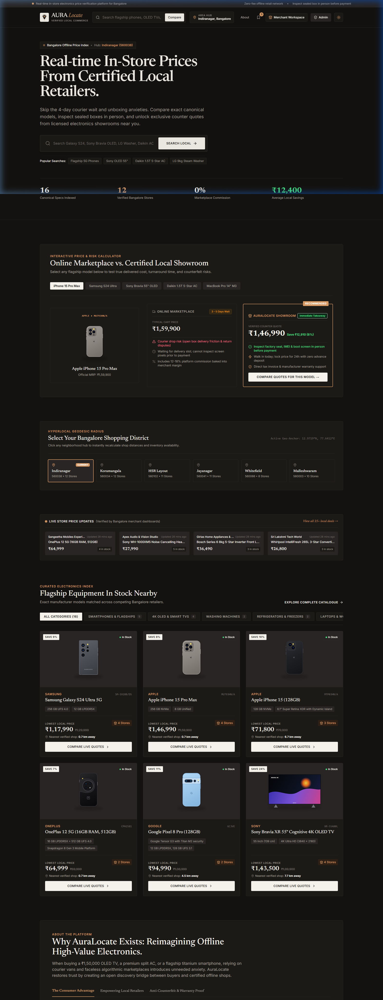

---

### 2. Verified Catalogue & Canonical Filter System
*Compare verified manufacturer models across 6 categories with real-time stock counts and verified local pricing.*

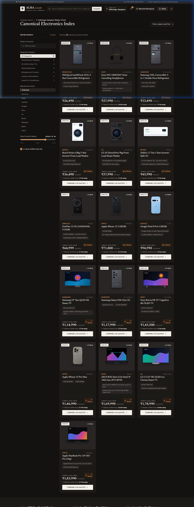

---

### 3. Store-by-Store Real-Time Price & Inventory Comparison
*Transparent pricing matrix matching exact canonical specifications against competing local dealers, showing warranty terms, distance in kilometers, and 1-click reservations.*

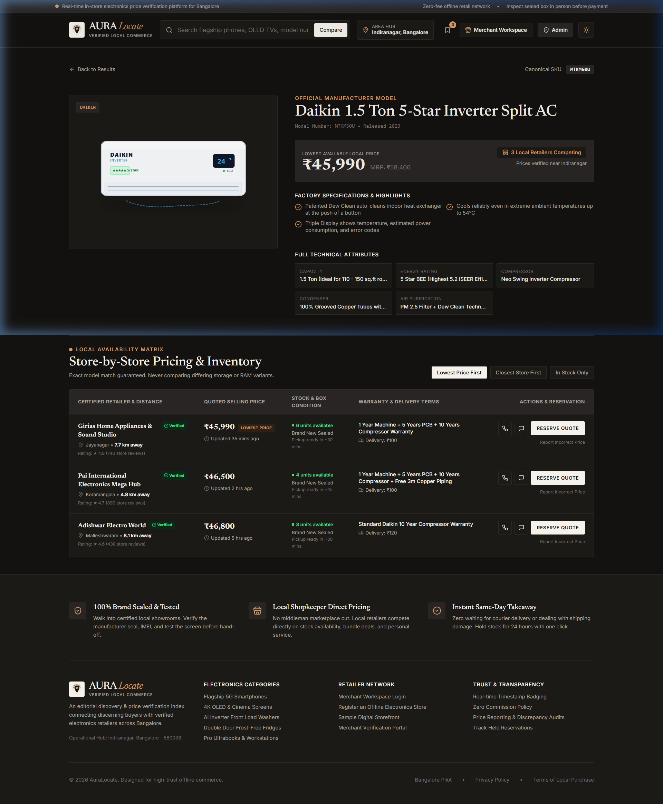

---

### 4. Verified Category Deep Dives
*Accurate, verified vector product illustrations matching exact brand, model, and form factors.*

| Inverter Air Conditioners | AI DirectDrive Washing Machines |
| :---: | :---: |
| 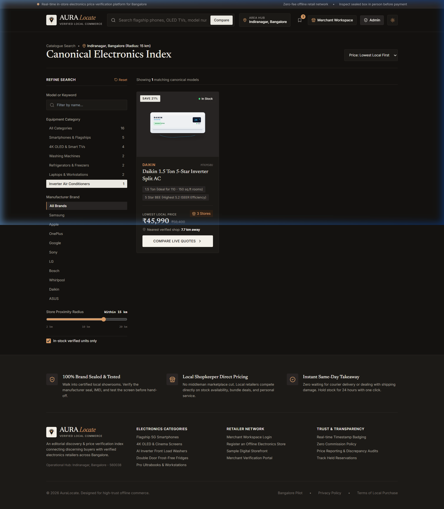 | 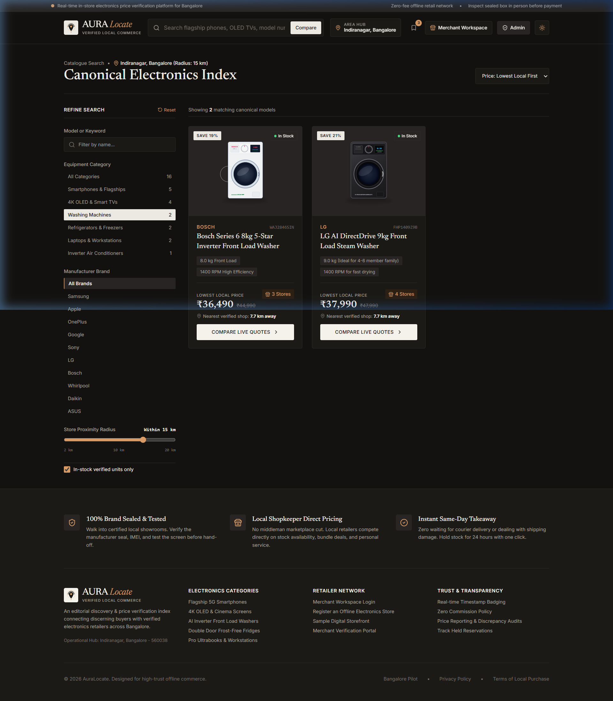 |

---

### 5. Instant 1-Click 24-Hour Stock Reservation
*Customers secure sealed-box inventory and lock guaranteed price quotes with zero prepayment.*

| Customer Reservation Modal | Real-Time Hold Tracker |
| :---: | :---: |
| 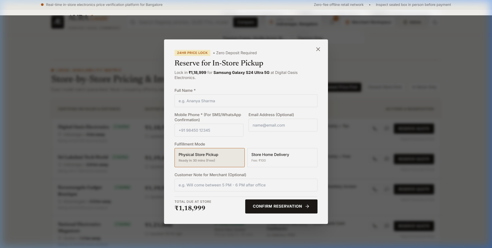 | 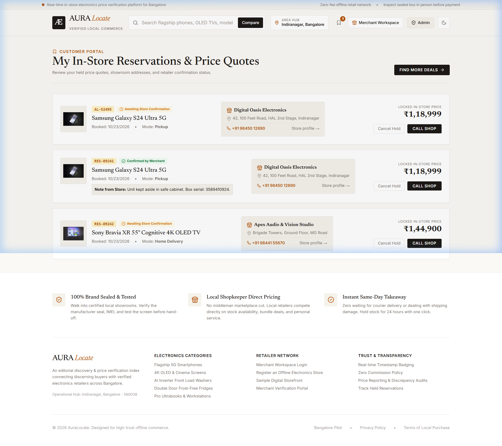 |

---

### 6. Merchant Management Workspace & Digital Storefronts
*Shopkeepers update live selling prices, manage customer reservation queues, and share their dedicated showroom page.*

| Merchant Real-Time Dashboard | Shareable Digital Storefront |
| :---: | :---: |
| 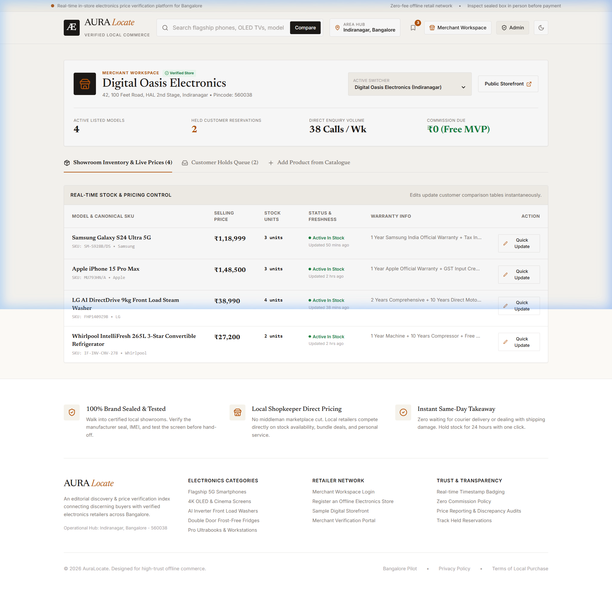 | 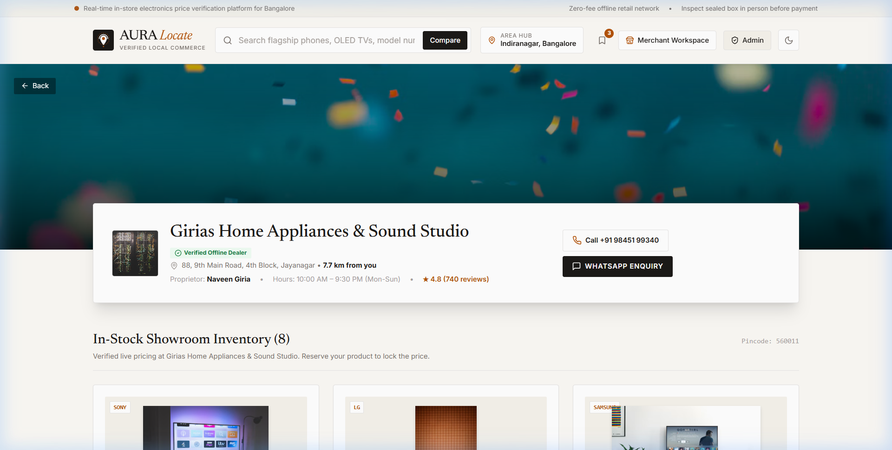 |

---

### 7. Administrative Oversight & Price Discrepancy Audits
*Platform administrators verify physical showroom licenses, inspect consumer price discrepancy reports, and audit canonical models.*

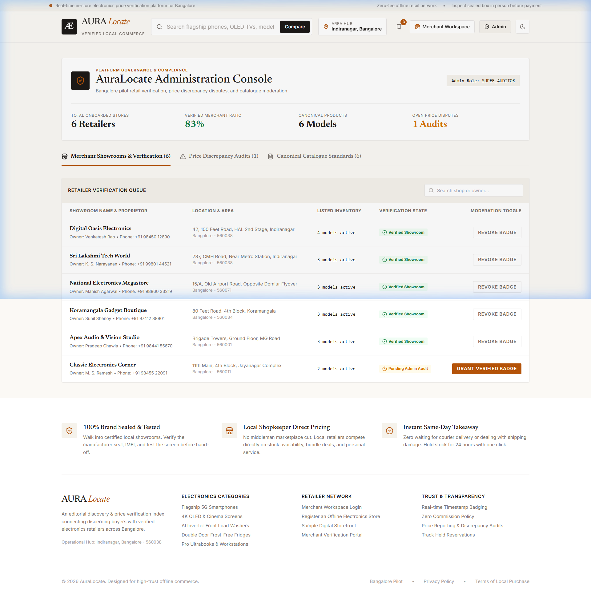

---

### 8. Architectural Aesthetics & Dark Mode
*Built on **Theme B (Aura Atelier)** with warm alabaster surfaces (`#FBF9F5`), espresso roast dark mode (`#141210`), and burnished bronze accents (`#B45309`).*

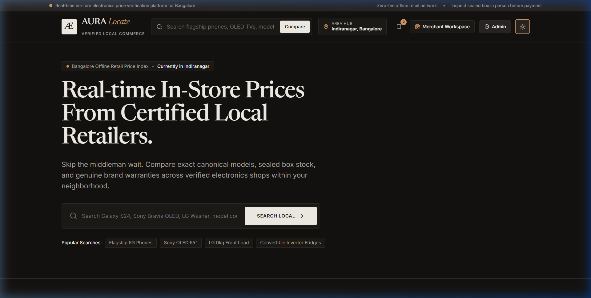

---

## 🏛️ System Architecture & Workflow

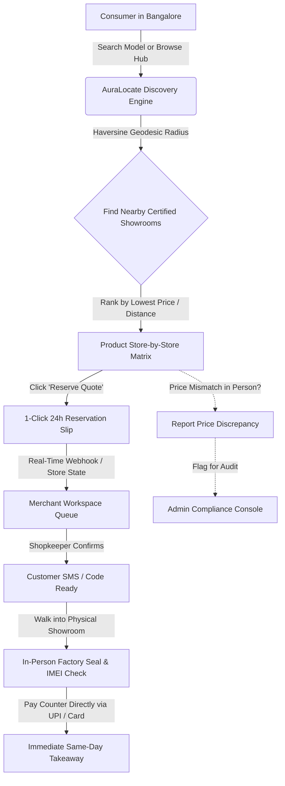

---

## 🚀 Key Feature Breakdown

### 1. Consumer Discovery & Comparison
- **Exact Canonical SKU Matching**: Prevents deceptive variants (e.g., comparing 256GB vs 128GB or different display panel specs).
- **Online vs. Local Savings Simulator**: Demonstrates live cost differences, turnaround time, and warranty benefits against online marketplaces.
- **Hyperlocal Haversine Distance Engine**: Real-time geodesic distance calculations from the user's active Bangalore area hub (Indiranagar, Koramangala, HSR Layout, Whitefield, Jayanagar, Malleshwaram).

### 2. High-Trust Offline Workflow
- **24-Hour Stock Reservation**: Locks physical inventory at the quoted price with ₹0 advance commitment.
- **In-Person Seal Inspection**: Buyers verify holographic manufacturer packaging and serial numbers on official brand portals before billing.
- **Zero Commission Guarantee**: 100% of the customer's payment goes directly to the merchant without 12-18% platform cuts.

### 3. Retailer Empowerment
- **Mobile-First Merchant Workspace**: Shopkeepers update stock counts and selling prices in under 30 seconds.
- **Dedicated Storefront URLs**: Every licensed merchant gets a public shareable page (`/shop/[slug]`).
- **Active Hold Queue Management**: Accept, fulfill, or manage customer pickup holds.

### 4. Platform Trust & Governance
- **Administrative Merchant Verification**: Showroom GST, dealer certificates, and physical address inspections.
- **Community Price Discrepancy Audits**: 1-click reporting ensures shopkeepers honor online quotes in-store.
- **Automatic State Synchronization**: LocalStorage caching with semantic dataset versioning (`v3_verified_accurate_images`).

---

## 🛠️ Technology Stack

| Layer | Technology | Details |
| :--- | :--- | :--- |
| **Framework** | Next.js 15.1.0 | App Router with Turbopack, SSR & Static Generation |
| **UI Library** | React 19.0.0 | Server Components & Client Hooks |
| **Styling** | Vanilla CSS + Tailwind CSS 3.4 | Custom CSS Variables design system (`Aura Atelier`) |
| **Typography** | Google Fonts | Newsreader Serif headings & Inter body typography |
| **Icons** | Lucide React 0.469 | Feather-grade, lightweight SVG icons |
| **Icons/Assets**| Custom Vector SVGs | Product-accurate, verified, lightweight assets in `/public/products/` |
| **Deployment**| Vercel | Zero-config edge deployment with `vercel.json` |

---

## 📁 Project Directory Structure

```text
B2c/
├── public/
│   ├── products/               # Verified, product-accurate vector illustrations
│   │   ├── daikin-ac-15t.svg
│   │   ├── s24-ultra.svg
│   │   ├── iphone15-promax.svg
│   │   ├── sony-bravia-oled.svg
│   │   ├── lg-washer-9kg.svg
│   │   └── ... (16 canonical products)
├── docs/
│   └── screenshots/            # Visual tour screenshots for repository README
├── src/
│   ├── app/
│   │   ├── layout.tsx          # Root layout with Theme & Platform Provider
│   │   ├── page.tsx            # Interactive Homepage & About platform section
│   │   ├── search/             # Canonical catalogue search & filter grid
│   │   ├── product/[id]/       # Product comparison & store-by-store matrix
│   │   ├── shop/[slug]/        # Merchant digital storefront
│   │   ├── merchant/           # Retailer stock & reservations workspace
│   │   ├── admin/              # Administrative verification & price audit console
│   │   ├── reservations/       # Customer pickup holds tracker
│   │   └── globals.css         # Aura Atelier CSS design tokens (light & dark)
│   ├── components/
│   │   ├── AuraLogo.tsx        # Bespoke concentric beacon logo
│   │   ├── Navbar.tsx          # Editorial navigation with live search
│   │   ├── Footer.tsx          # Platform trust pillars & links
│   │   ├── ProductCard.tsx     # Canonical product presentation card
│   │   ├── ReservationModal.tsx# 1-click 24h pickup hold modal
│   │   ├── LocationModal.tsx   # Bangalore neighborhood & radius selector
│   │   ├── PriceReportModal.tsx# Community price discrepancy reporting
│   │   └── ThemeToggle.tsx     # Light/Dark mode switcher
│   ├── lib/
│   │   ├── mockData.ts         # 12 Bangalore retailers, 16 canonical products & listings
│   │   └── store.tsx           # React Context state management & distance formulas
│   └── types/
│       └── index.ts            # Strongly typed TypeScript interfaces
├── next.config.ts              # Next.js config with wildcard remote image patterns
├── vercel.json                 # Vercel deployment specification
├── package.json                # Project dependencies & scripts
└── README.md                   # Comprehensive repository documentation
```

---

## 💻 Getting Started Locally

### Prerequisites
- Node.js `18.17.0` or higher
- npm `9.0.0` or higher

### Installation & Run

1. **Clone the Repository**:
   ```bash
   git clone https://github.com/arpitmishra6567/AuraLocate.git
   cd AuraLocate
   ```

2. **Install Dependencies**:
   ```bash
   npm install
   ```

3. **Start the Development Server**:
   ```bash
   npm run dev
   ```
   Open [http://localhost:3000](http://localhost:3000) in your browser.

4. **Run Production Build Verification**:
   ```bash
   npm run build
   npm run start
   ```

---

## ☁️ Deploying to Vercel

The project includes pre-configured [`vercel.json`](./vercel.json) and [`next.config.ts`](./next.config.ts) files for zero-configuration deployments.

### Method 1: Using the Vercel CLI (Recommended)
```bash
# Install Vercel CLI globally if needed
npm install -g vercel

# Deploy directly
vercel --prod
```

### Method 2: Via GitHub Integration
1. Push this repository to your GitHub account (`https://github.com/arpitmishra6567/AuraLocate.git`).
2. Go to [vercel.com/new](https://vercel.com/new).
3. Import your `AuraLocate` repository.
4. Click **Deploy**. Vercel will automatically build all static pages and edge routes.

---

## 🛡️ License

Built with pride for high-trust offline commerce in Bangalore. Distributed under the MIT License.
